# TrSS

**Tamasrazim's Real-time Scene Synthesis**

TrSS is an experimental, local-first neural-rendering research engine targeting Intel Arc GPUs, with the Arc B580 12 GB as its first hardware target. The long-term goal is photorealistic neural appearance reconstruction: learning to improve lighting, materials, fine detail, and temporal stability. Super-resolution is an optional component, not the entire product.

TrSS keeps its first-party PyTorch training pipeline, paired-frame dataset loader, checkpoint and inference tooling, frame/tensor contracts, temporal-history management, GPU diagnostics, an experimental Vulkan/XMX research backend, and native Windows API probes for legacy Direct3D 9, Direct3D 11, and Direct3D 12.

> **Current status — 15 October 2026:** the first-party model is still a trainable 2× frame-reconstruction baseline with a simple temporal blend. It is **not** yet a photorealistic neural renderer. No trained weights or paired dataset are bundled. The first-party Windows x64 DXGI/D3D11 runtime now has flip-model back-buffer selection, resource guards, x64 executable validation, and checksum-aware uninstall; its native build and installer tests pass in CI. The live runtime still applies conventional post-processing, not the PyTorch model. Real game testing, live depth/motion/history acquisition, trained-model integration, and physical Arc B580 validation remain outstanding.

TrSS is independent research software and is not affiliated with, endorsed by, or a product of Intel or NVIDIA.


## Project progress

**Overall engineering estimate toward a complete, live, physically validated neural renderer: 65%**




This is an engineering roadmap estimate, not a measured performance figure, test-coverage score, or claim that real-time neural rendering already works. The latest renderer work improves the experimental runtime's flip-model back-buffer handling and resource guards, validates the target executable's x64 PE architecture before installation, and tests the installer's PE-signature checks. Recorder changes also ensure sampled Windows counters are included in the game bundle and the archive's SHA-256 manifest is checked before cleanup. The native runtime build and installer tests pass in CI, but that only proves the tested source compiles and the installer checks pass. It does not verify that a real game can use the proxy. Because the core neural-model integration, live game-buffer acquisition, and physical Arc B580 validation remain incomplete, the overall estimate stays at 65%. The light sweep in the progress graphic is decorative animation.

| Workstream | Current status |
| --- | --- |
| Python inference, model inspection, and device selection | Implemented |
| Frame/tensor contracts and offline frame adapters | Implemented |
| Temporal-history safety and CPU-side tests | Implemented |
| Dataset-split leakage checks and resume-setting validation | Implemented; automated tests |
| Scene-grouped training/validation manifest splitter | Implemented; deterministic and path-validated |
| Paired-render dataset audit | Checks image/tensor contracts, scene leakage, exact/perceptual duplicates, paired-image consistency metrics, motion clipping, and provenance metadata |
| Offline visual pair-review gallery | Scene-balanced thumbnails, searchable local HTML, source paths, and decode-error report |
| Offline checkpoint timing breakdown | Separates setup, model, composition, and output writing; not live FPS |
| Direct3D 9 legacy render-target probe | Experimental; device/clear/readback test only |
| Direct3D 11 compute probe | Experimental; HLSL dispatch/readback test only |
| Direct3D 12 compute probe | Experimental; HLSL dispatch/readback test only |
| Native Vulkan/XMX execution path | Experimental; hardware validation remains |
| First-party per-game live graphics runtime | Experimental Windows x64 D3D11/DXGI prototype; flip-model back-buffer selection and resource guards added; native build passes CI; actual game compatibility unverified |
| Runtime installer safety | x64 PE target validation, existing-`dxgi.dll` refusal, SHA-256 manifest, checksum-aware removal, and installer tests implemented |
| Verified neural-rendering model and compatible weights | Trainable model code exists; no trained checkpoint or dataset is bundled or validated |
| Game Library recorder and local session bundles | Game discovery/launch, configurable local capture destination, opt-in PNG samples, timestamped `performance.jsonl`, graphics-profile review, complete SHA-256 ZIP verification, and local CSV/JSONL matrix are implemented; actual PC/game validation remains |
| Recorder performance measurements | CPU, memory, and some per-process GPU/VRAM counters when Windows exposes them; sample rate is not game FPS |
| Native game FPS, frametime, and 1% lows | Not implemented; missing values remain unavailable rather than guessed |
| Renderer-native capture for neural training | Not implemented: game color/depth/motion/history buffers and paired reference frames are not produced by the recorder |
| Independent Baseline / TrSS comparison | Implemented for matching game, experiment group, and settings hash; CSV/JSON output; comparisons remain descriptive, not causal proof |
| Live game-frame inputs for neural inference | Not yet implemented: real live color/depth/motion/history feeding the trained PyTorch model is outstanding |
| Visual-quality, latency, and performance validation on a physical Arc B580 | Not yet completed |

The recorder has its own status and next-step guide in [docs/RECORDER-README.md](docs/RECORDER-README.md). Its core capture, persistent output-folder selection, telemetry-bundle, graphics-matrix, and archive-integrity workflows are implemented. There is deliberately no recorder-completion percentage while native frame-event telemetry, long-session validation, and real-game compatibility testing remain unfinished.

TrSS is independent research software. The engine must not label a conventional filter or generic super-resolution model as neural rendering.

## What is implemented

- **OpenVINO device discovery:** lists the GPU devices actually exposed by the installed runtime, including distinct `GPU.X` adapters.
- **Strict Arc selection:** `ARC` resolves only when one device is identified as Intel Arc. Ambiguous Arc devices must be selected explicitly; a CPU fallback is rejected.
- **Single-image inference:** a convenience path for one rank-four RGB image input and one image output, with NCHW/NHWC layout, RGB/BGR channels, numeric range, FP16/FP32 input, warm-up calls, repeated measurements, and JSON reports.
- **Model inspection:** reads a local ONNX/OpenVINO-supported model and describes its input/output names, shapes, and precision without running inference.
- **Multi-input/multi-output inference:** named tensors are checked against the model's actual ports. Dynamic shapes are specialized and compiled for the selected GPU; outputs and timing details are returned explicitly.
- **Graphics-frame contract:** `FramePacket` carries source color plus only those depth, motion-vector, noise, and conditioning buffers actually supplied by the source, along with color/depth/motion conventions.
- **Spec-driven frame adapter:** an explicit JSON file maps model port names to frame sources, tensor layouts, resampling rules, channel order, and numeric ranges. Static model sizes are honored; missing depth/motion/history is an error, not fabricated input.
- **Offline frame inference command:** `render-frame` feeds a screenshot and real auxiliary `.npy` buffers through the adapter into a multi-input model, writes raw output tensors, and records preprocessing/compile/inference timings. It is a model-pipeline test, not a live game hook.
- **Offline temporal sequence runner:** `render-sequence` reads an explicit JSONL manifest, processes recorded frames in order, carries normalized RGB history only across continuous frames, and resets history after camera cuts, scene/resolution changes, gaps, or stale timestamps. Required depth/motion inputs must be real files; after a history reset, a model that needs history requires an explicit `initial_history` seed.
- **TrSS Game Library (`trss-recorder`):** a Windows game grid discovers Steam/Epic installs and common or user-selected game folders, extracts executable icons, launches titles, and shows a click-through performance overlay. After every capture, a post-run graphics review collects and verifies the game's current settings. First-party config readers extract only recognized graphics keys from common local settings files; every bundle stores `graphics_settings.json` and a hash-addressed `game_matrix_row.json`. Repeated captures build a shared local `game-matrix.csv` / `game-matrix.jsonl` across profiles. FPS, frametime, and 1% lows remain unavailable until TrSS's own frame-event collector exists; the recorder does not produce renderer-native depth/motion/history buffers. No third-party telemetry executable is bundled. See the user's [recorder developer README](docs/RECORDER-README.md) and [capture guide](docs/RECORDER.md).
- **First-party live runtime prototype:** `native/runtime/` builds an app-local `dxgi.dll` proxy for a limited set of compatible Direct3D 11/DXGI games. The current source handles the active back buffer for compatible flip-model swap chains and guards resource setup; the installer validates an x64 executable, refuses to overwrite an existing `dxgi.dll`, and uses a SHA-256 manifest for safe removal. Install with `TrSS-Runtime-Installer.exe`, then use Ctrl+Alt+Page Up for the in-game post-processing menu, built-in looks, and editable effect controls. CI build/installer checks pass, but a real game test is still outstanding. The runtime uses conventional post-processing and is not yet a live PyTorch renderer; D3D9, D3D12, Vulkan and OpenGL are outside the current runtime. See [docs/RUNTIME.md](docs/RUNTIME.md) and the plain-language [renderer developer README](docs/RENDERER.md).
- **Independent baseline comparison:** `trss-compare-performance` compares separate recorder sessions for `Baseline` and `TrSS` profiles only when game, experiment group, and game-graphics settings hash match. It exports CSV/JSON differences and preserves missing FPS values. Logs are evaluation data, not direct PyTorch image-training targets.
- **Specialized HNet-style frame contract:** `trss/rendering/hnet.py` packs the documented 16-channel feature tensor, deterministic noise, exact staged FP16 color scaling, network field padding, and the four-channel residual/temporal-gate composition. `hnet-frame` connects that adapter to a supplied, shape-compatible OpenVINO model.
- **Experimental native XMX bridge:** `xmx-frame` connects the vendored Intel Xe2 Vulkan/XMX frame runner to the same feature and output-head contract. It checks for a compiled native library and required shaders, refuses non-Arc devices, accepts only a compatible fully-logical safetensors weight file, and reports native execution and whole-frame timings.
- **DirectX 9/11/12 API probes:** `native/directx12/` builds three separate executables. Direct3D 9 creates a legacy device and verifies a cleared render target through readback; D3D11 runs an HLSL compute test; D3D12 runs a separate HLSL compute/fence test. D3D11 and D3D12 have WARP CI tests. These are native API smoke tests, not game hooks, neural inference, or B580 performance validation.
- **Temporal history safety:** previous outputs can be kept between frames, but are invalidated after camera cuts, scene/resolution changes, frame-order gaps, or stale timestamps.
- **Offline paired-frame review gallery:** `trss.training.review_dataset` and `trss-review-dataset` create a responsive, searchable HTML page with local thumbnails for a deterministic sample balanced across scene IDs. The tool exposes source paths, dimensions, history-reset state, and image decoding errors for manual review without altering the source dataset.
- **Paired-render dataset audit:** `trss.training.audit_dataset` and `trss-audit-dataset` validate the actual frame files, 2× image-size contract, depth/motion/history shapes and ranges, scene disjointness, exact decoded-pixel duplicates across the two splits, and optional provenance JSON. A banded 64-bit difference-hash search reports likely near-duplicates across splits as warnings. The audit also compares each low-resolution input against its high-resolution target reduced with the BOX filter, reporting per-frame MAE/RMSE/PSNR and split summaries. This is only a pairing sanity-check proxy—not proof of alignment or render quality.
- **Scene-separated dataset split tool:** `trss.training.split_manifest` and `trss-split-dataset` build deterministic training/validation manifests by complete `scene_id` groups, validate referenced files, reject exact cross-scene reuse of input/target frames, preserve provenance fields, and rebase output paths. It organizes supplied data; it does not create training frames.
- **First-party TrSS training model:** a trainable 10-channel, 2x temporal reconstruction baseline with paired-frame validation, motion-aware flip augmentation, full-frame tiled validation, resumable AdamW/RNG checkpoints, and MAE/PSNR comparison against bicubic interpolation. It has no trained weights yet and is not wired into the fixed-graph native XMX runner.
- **TrSS model performance telemetry:** offline inference on a trained checkpoint records synchronized per-iteration model and compositor latency, mean/median/p95/p99 summaries, compute-capacity estimates against a 60 FPS budget, checkpoint/config/device identity, and process allocator memory when exposed by the selected PyTorch backend. A `--telemetry-jsonl` option appends repeatable run records. These measurements describe the TrSS model path, not live-game FPS; the repository does not bundle trained weights.
- **Automated CPU-side tests:** fake-runtime tests exercise model binding, shape changes, GPU-selection rules, data validation, XMX-frame orchestration, and temporal history. CI builds the vendored native runtime, host helpers, and all runtime SPIR-V shaders; it still does not execute them on an Arc GPU.

The frame and tensor layers are infrastructure for a neural renderer. They are not themselves a trained rendering model, a game capture hook, or proof of support on a physical Arc B580.

## Setup

Use Python 3.10 or newer. On Windows PowerShell, from the repository folder:

```powershell
py -3 -m venv .venv
.\.venv\Scripts\Activate.ps1
python -m pip install --upgrade pip
python -m pip install -e ".[gpu,test]"
```

OpenVINO GPU support also depends on a compatible Intel graphics driver and the installed runtime's GPU plugin.

## Commands

### Launch games and collect an opt-in sample (Windows 10/11)

Install TrSS and launch the game library:

```powershell
python -m pip install -e .
trss-recorder
```

Select a detected game card to launch it. The library extracts the executable's icon and tints its ambient background as cards are hovered. The overlay displays CPU, RAM, and available Windows GPU/VRAM counters; native game FPS, frametime, and 1% lows remain unavailable until the first-party TrSS frame-event collector is implemented. Check both consent boxes, then use Ctrl+Alt+F8 to start/stop an unlimited-duration session, Ctrl+Alt+F10 to stop, and Ctrl+Alt+F9 to restore the library.

After every recording, TrSS opens a graphics-profile review. It reads allowlisted settings from common game config files where possible and asks you to confirm the values against the game's own Graphics / Display menu. Fill every standard field with an exact value or an explicit applicability state; unknowns and unresolved numeric config enums keep the row marked incomplete. Repeat the capture after changing settings to populate a controlled matrix. Bundles contain `graphics_settings.json` and `game_matrix_row.json`; the cumulative local CSV and JSONL matrix are stored under `%LOCALAPPDATA%\\TrSS\\GameLibrary\\matrix`. Use the **Matrix folder** button to open them. See [the game library guide](docs/RECORDER.md).

**Research limitation:** generic Windows tooling cannot read the active settings menu of every game through one universal API. Config-file detection is best-effort, and in-game confirmation is required for an exact row. Screenshot capture is not renderer-buffer capture: the sample does not extract depth, motion vectors, temporal history, or paired reference renders, so it is not a standalone supervised-model training dataset.

### Install the first-party TrSS live runtime (experimental)

The Windows **Build first-party TrSS live runtime** workflow compiles the runtime and packages a single-file installer. Download the `TrSS-Live-Runtime-windows-x64` artifact from its [latest workflow run](https://github.com/Tamasrazim/TrSS/actions/workflows/build-trss-runtime.yml).

Run `TrSS-Runtime-Installer.exe`, select the actual supported game's executable, then choose **Install runtime**. Start the game normally and press **Ctrl+Alt+Page Up** to open or hide TrSS's menu. The first prototype exposes brightness, contrast, saturation, gamma, sharpening, bloom, vignette, film grain, color temperature and chromatic aberration, plus Neutral, Cinematic, Vibrant, Clarity, Night and Film presets. Custom presets can be saved or loaded.

This is a first-party D3D11/DXGI prototype with a successful CI compile and installer tests, **not universal support or a completed neural-rendering integration**. It has not yet been verified in a real game on your PC. D3D9/D3D12/Vulkan/OpenGL and some swapchain formats are not supported. The installer refuses to overwrite an existing `dxgi.dll`. Do not use it to bypass anti-cheat or game protections. Full scope and uninstall instructions: [docs/RUNTIME.md](docs/RUNTIME.md).

### Compare independent Baseline and TrSS recording runs

Record a baseline with the runtime absent, then install TrSS and record the same game scene again. In the recorder's post-capture review, set the first profile label to `Baseline` and the second to a precise renderer/preset label such as `TrSS - Cinematic`. Use the **same experiment group** and verify identical in-game graphics settings. Repeat both runs for stable results. The recorder does not need to connect to TrSS rendering.

~~~powershell
trss-compare-performance --matrix "$env:LOCALAPPDATA\TrSS\GameLibrary\matrix\game-matrix.jsonl" --output-dir "logs\performance-comparison" --baseline-profile "Baseline" --trss-profile "TrSS - Cinematic" --require-exact
~~~

The output CSV/JSON compares available per-process CPU/GPU/VRAM/RAM metrics and flags rows that cannot be safely paired. FPS and frametime are omitted while those measurements are unavailable. Performance differences help evaluate runtime overhead; they are not evidence for visual quality by themselves. Neural reconstruction training still needs aligned input/reference images and real depth, motion and history buffers—not just CSV performance logs.


### Identify the actual adapter

```powershell
trss devices
```

TrSS prints the device IDs and names it detects. It refuses to claim Arc selection when it can't distinguish an Arc GPU. On a machine with multiple Intel Arc GPUs, pass an explicit device such as `GPU.1`.

### Inspect a model before executing it

```powershell
trss inspect --model "models\your-model.onnx"
```

The command shows every named input and output, its shape, and its precision. Do this before preparing tensors; TrSS intentionally does not invent preprocessing semantics for unknown models.

### Run a simple image-to-image model

```powershell
trss infer --model "models\your-model.onnx" --input "input.png" --output "output.png" --device ARC --layout NCHW --input-channel-order RGB --output-channel-order RGB --input-range 0:1 --output-range 0:1 --warmup 3 --iterations 10 --report "logs\run.json"
```

Use this only for a model that truly expects a single rank-four image tensor and returns a rank-four image tensor. Confirm channel order, layout, dimensions, and ranges from the model's documentation. The reported inference-equivalent FPS is only the reciprocal of the isolated model time; it is not game FPS.

### Adapt a captured frame to model inputs

For a model whose port semantics you have verified, create a model-specific JSON file using [the adapter template](docs/examples/adapter-template.json), then run a saved frame with the actual auxiliary buffers available to your capture workflow:

```powershell
trss render-frame --model "models\render-model.onnx" --spec "models\render-adapter.json" --color "frames\frame-0001.png" --depth "frames\depth-0001.npy" --motion "frames\motion-0001.npy" --history "frames\previous-output.npy" --output-dir "work\frame-output" --preview-output "work\frame.png" --history-output "work\frame-history.npy" --device ARC --warmup 2 --iterations 10 --report "logs\frame-report.json"
```

Only provide buffers that actually exist and that the adapter spec requires. Preview and history output require an explicit direct-RGB output declaration in the spec; feature planes and packed neural heads need a model-specific composition routine. History output is HWC float32 in the [0, 1] range. Depth and motion encoding, color space, model-specific noise, tensor normalization, temporal reprojection, and output-head composition must match the chosen model's documentation. See [MODEL-ADAPTERS.md](docs/MODEL-ADAPTERS.md). This command processes offline frame files; it does not capture a live game or claim real-time performance.

### Process an offline frame sequence with temporal history

Use [the JSONL manifest example](docs/examples/sequence-manifest.jsonl) as a template. Each non-empty line describes one frame. Paths are relative to the manifest unless absolute. The `color` image is required; `depth`, `motion`, `noise`, and `conditioning` are optional only when the selected model does not require them. A history-consuming model also needs a real `initial_history` RGB HWC `.npy` array in float32-compatible values from 0 to 1 on the first frame and after any reset where no continuous history remains.

```powershell
trss render-sequence --model "models\render-model.onnx" --spec "models\render-adapter.json" --manifest "frames\sequence.jsonl" --output-dir "work\sequence-render" --device ARC --report "logs\sequence-report.json"
```

Each output is written as an ordered PNG in the output directory. The report includes per-frame preprocessing, compile, inference and wall timings, adapter/device details, available inputs, and whether history was reused or seeded. This path is sequential offline processing—not real-time capture or game FPS—and it never creates fake depth or motion data.

### Execute a model with multiple named tensors

For a model with color, depth, motion, history, or conditioning inputs, save the exact tensors expected by that model as NumPy `.npy` files and pass one `--input NAME=FILE.npy` argument per declared input:

```powershell
trss infer-tensors --model "models\render-model.onnx" --input "color=work\color.npy" --input "depth=work\depth.npy" --input "motion=work\motion.npy" --output-dir "work\outputs" --device ARC --warmup 2 --iterations 10 --report "logs\tensor-run.json"
```

Names must exactly match the model's input ports, and tensors must match the expected dimensions, precision, units, and preprocessing. The engine refuses missing/extra names, non-finite values, and complex inputs. It does not infer depth or motion vectors from color; those buffers must come from a real, documented source or a deliberate model-specific preprocessing stage.

### Run the HNet-style 16-to-4-channel frame adapter

The specialized adapter is for a compatible, user-supplied model that accepts the documented `[1,16,H,W]` feature tensor and emits a `[1,4,H,W]` head. It builds the frame conditioning and applies the documented residual/gate composition around the supplied model. It does not contain model weights or a neural graph.

```powershell
trss inspect --model "models\your-hnet-model.onnx"
trss hnet-frame --model "models\your-hnet-model.onnx" --color "frames\input.png" --output "work\rendered.png" --device ARC --output-layout NCHW --frame-index 0 --style-index 0 --tone-strength 1 --structure-strength 1 --warmup 1 --iterations 5 --history-output "work\next-history.npy" --head-output "work\raw-head.npy" --report "logs\hnet-frame.json"
```

The command refuses incompatible input/output shapes rather than pretending any rank-four network is the expected graph. A supplied model must also have matching weights, input preprocessing, head output semantics, and legal terms. The report's timing separates model inference from the whole offline frame path; neither is in-game FPS. Previous history is optional for the first frame and, when provided, must be an RGB HWC `.npy` array in the 0..1 range.

### Train the original TrSS reconstruction model

The first-party model and training contract are documented in [docs/TRAINING.md](docs/TRAINING.md). PyTorch's official Intel GPU wheels are needed for training on an Arc card; the regular runtime install does not include PyTorch.

```powershell
python -m pip install torch --index-url https://download.pytorch.org/whl/xpu
python -m pip install -e ".[training,test]"
python -m trss.training.model --channels 48 --blocks 10 --context-blocks 4
python -m trss.training.train --train-manifest data/train.jsonl --validation-manifest data/validation.jsonl --output-dir models/trss-quality --device xpu --channels 48 --blocks 10 --context-blocks 4 --patch-size 128 --batch-size 1 --epochs 100 --amp
python -m trss.training.infer --checkpoint models/trss-quality/checkpoint-best.pt --color frames/low.png --depth frames/depth.npy --motion frames/motion.npy --output work/trss-output.png --device xpu --warmup 2 --iterations 5 --report logs/inference.json
```

This requires your own paired, legally usable renders plus real depth, motion and correctly reprojected history data. No dataset or pretrained weights are included. The new checkpoint format is not yet compatible with `xmx-frame`; that needs a separate native implementation.

### Probe DirectX 9, DirectX 11, and DirectX 12

Different games use different graphics APIs. TrSS now builds separate native probes for legacy Direct3D 9, Direct3D 11, and Direct3D 12. These verify basic API operations on a selected adapter; they do **not** hook a game or run the TrSS neural model yet.

Build the targets in a Visual Studio developer environment with CMake and the Windows SDK:

```powershell
cmake -S native/directx12 -B native/directx12/build -A x64
cmake --build native/directx12/build --config Release --parallel
```

List devices for each API:

```powershell
trss graphics-probe --api d3d9 --list-devices
trss graphics-probe --api d3d11 --list-devices
trss graphics-probe --api d3d12 --list-devices
```

Run hardware smoke tests on the Arc adapter:

```powershell
trss graphics-probe --api d3d9 --self-test --device-substring B580
trss graphics-probe --api d3d11 --self-test --device-substring B580
trss graphics-probe --api d3d12 --self-test --device-substring B580
```

D3D9 tests device creation and render-target readback because Direct3D 9 has no compute shaders. D3D11 and D3D12 test their own HLSL compute paths. `--warp-self-test` is available for D3D11 and D3D12 CI smoke tests; it uses a software adapter and does not measure Arc performance. The older `dx12-probe` command remains as an alias for `graphics-probe`.

See [docs/DIRECTX12.md](docs/DIRECTX12.md) for details and current limits. Full game support still requires API-specific frame acquisition, resource sharing or copying, synchronization, frame pacing, resize/device-loss handling, and real integration tests for each supported game/API combination.

### Run the experimental native Intel Arc XMX frame path

This path uses the native Vulkan/XMX graph directly as a separate execution path. It requires the Vulkan SDK/loader, a GCC or Clang toolchain that supports `_Float16` (MSVC is not supported by the vendored native CMake project), the generated SPIR-V shaders, and a compatible legal `fully_logical=true` safetensors file. TrSS does not include trained weights, proprietary DLLs, or extracted vendor parameters.

From a shell where CMake can find the Vulkan SDK and the GCC/Clang toolchain, build the native source out of tree:

```powershell
cmake -S vendor/dlss-nr-intel -B vendor/dlss-nr-intel/work/cmake -DNR_BUILD_LAYER=OFF -DNR_BUILD_TESTS=OFF
cmake --build vendor/dlss-nr-intel/work/cmake --config Release --parallel
```

Then run an offline frame:

```powershell
trss xmx-frame --weights "models\your-logical-weights.safetensors" --color "frames\input.png" --output "work\rendered.png" --warmup 1 --iterations 5 --report "logs\xmx-frame.json"
```

When a machine has multiple Vulkan adapters, use `--vulkan-device "B580"` only if that substring uniquely identifies the target card. The command verifies the reported Vulkan device name contains `Arc`. Its FPS-equivalent number reflects only the warmed native frame-runner timing, not complete game FPS. This path has not yet been validated on a physical Arc B580 and does not capture live game frames.

### Run the tests

```powershell
python -m pytest
```

CI checks syntax and the CPU-only test suite. CI does not have the target Arc B580, so it cannot prove GPU inference speed or visual results.

## Still missing for actual neural rendering

1. **A verified model-specific neural-rendering model.** The generic JSON adapter and a specialized HNet-style 16-to-4 frame contract are implemented, but the actual graph and legally usable parameters are not bundled. Exact tensor semantics, weights, precision, temporal behavior, and all model-specific post-processing still require verification against a compatible model.
2. **Model parameters.** Source code and trained weights are different things. No proprietary graphics DLLs, extracted vendor parameters, or trained model are bundled with TrSS.
3. **A neural-model graphics-frame source.** The experimental D3D11/DXGI shim applies a post-processing shader to a presented image, but no live game color/depth/motion/history buffers feed the PyTorch model. Model commands still receive local images and explicit arrays.
4. **Temporal reprojection and composition.** The current history store invalidates unsafe history but does not calculate motion-vector reprojection or the network's exact history blend.
5. **Live PyTorch integration.** There is no TrSS Vulkan layer, and the D3D11 post-processing shim does not yet execute the PyTorch checkpoint. `hnet-frame` still processes local frame files through a supplied model.
6. **Physical hardware validation.** No TrSS run on the user's Arc B580 has yet established model compatibility, visual quality, latency, or in-game performance.
7. **End-to-end native validation.** The `xmx-frame` command connects TrSS's frame contract to the pinned Vulkan/XMX runner, but CPU tests use a fake frame runner and CI compilation does not establish Arc execution. A compatible licensed logical-weight file and a real Arc B580 render are still required. Separately, the D3D11/DXGI live runtime has passed its Windows CI build and installer tests, but still needs a real-game smoke test; it does not run the PyTorch checkpoint. Track the next renderer steps in [docs/RENDERER.md](docs/RENDERER.md).

A generic image model may demonstrate the inference pipeline, but it is not a stand-in for a game-conditioned neural renderer. The immediate engineering path is to finish the native XMX execution bridge and model-loader contract, validate it with a legally usable model artifact, then measure real-frame latency and visual quality on the physical B580.

## Dependencies and licensing

TrSS uses external runtimes and libraries for model inference, training, and native graphics execution. Required license and notice files are retained with the relevant source. Pretrained neural-rendering weights and datasets are not bundled.

The native Vulkan/XMX source is kept inside this repository under `vendor/`. Its code, shaders, and redistribution boundaries must follow the license and notice files included with the source. See [dependency and licensing boundaries](docs/THIRD-PARTY-RESEARCH.md) for the project's rules.

Any adopted code, model, shader, or dataset must have its exact version and license recorded before it becomes a dependency.

## Development rules

- Main branch only; commits land directly on `main`.
- No releases or extra branches.
- Local-first: no account, cloud inference, or subscription is required.
- Model and graphics claims are only added after an executable test supports them.
- Keep offline inference, native probes, the live post-processing prototype, and neural rendering clearly distinguished.
- Do not mark live-game compatibility or Arc B580 performance as validated until tested on that game and hardware.
